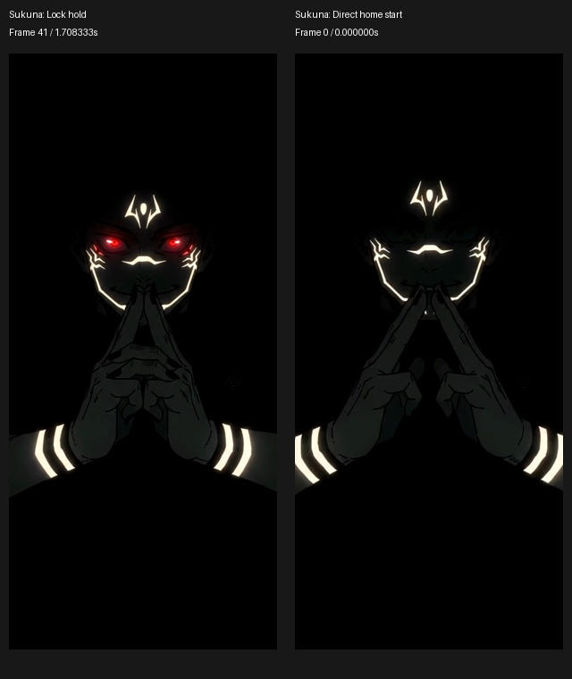

# Playback behavior and verification

## Lock and home behavior

- Lock wake plays the opening and pauses on a settled pose.
- Unlock after lock playback continues the same decoder and SurfaceTexture. It does not replay the opening or seek across a moving gesture.
- Direct AOD-to-home unlock starts the full supplied clip from frame zero. A new unlock can restart it even when a previous screen-off event was missed.
- Hiding the wallpaper stops decoding and clears the visible session. A USER_PRESENT received while hidden is retained until visibility reconciliation.

| State | Source frame | Packaged timestamp |
| --- | --- | --- |
| Last lock frame / hold | 41 | 1708333 us |
| Next frame when held lock continues | 42 | 1750000 us |
| Direct AOD-to-home start | 0 | 0 us |

Hand seal complete and face dark; hold before the blood drop begins.

The clip filename/hash and frame contract are in [`media-timing.json`](../media-timing.json). Video is native 24 fps, 1220x2712, height scaled and center cropped without stretching, with no audio or generated interpolation frames.



## Runtime ownership

`LiveWallpaperService$WallpaperEngine` owns SCREEN_ON, SCREEN_OFF, USER_PRESENT, visibility and pending-unlock reconciliation. Visibility controls playback; PowerManager.isInteractive can lag a wake callback and is not a playback veto. SCREEN_ON while hidden does not consume the clip. USER_PRESENT calls `WallpaperRenderer.onUnlocked`; an ordinary visibility refresh calls `onLocked`, keeping duplicate refreshes idempotent. Non-content lifecycle traces use `WallpaperPlayback` and `WallpaperVisibility` tags.

`WallpaperGLSurfaceView` owns EGL lifecycle and preserves its context on pause. `WallpaperEngine.onSurfaceDestroyed` must not clear renderer/player resources: a replacement window surface may reuse the same EGL context without another onSurfaceCreated. `WallpaperRenderer.setupResources` cleans/rebuilds GL resources on the GL thread. Engine destruction stops the GL thread and invokes `releasePlayer` to shut down the decoder.

`VideoPlayer.mPlaybackMode` is standby (0), lock (1) or home (2). `restartHome` continues a displayed, healthy mode-1 stream; otherwise it starts a fresh full home session. Fresh sessions recreate SurfaceTexture on the GL thread so a retained frame cannot be mistaken for the new frame-zero session. `onPlayingComplete` and `onResourcesLost` only update volatile state and request rendering, without acquiring the player monitor that reset holds while joining VideoHandlerThread.

`VideoPlayer$VideoHandler` serializes codec access: message 5 starts home, 6 starts lock, and 7 continues lock into home by clearing its pause target and resetting its presentation clock. Continuation never seeks or flushes. `VideoStream.advance` discards seek preroll before `mRenderFromUs`, retains media timestamps and pauses exactly at the configured hold. `VideoShader` uses the appropriate static fallback until a current-session frame arrives; released SurfaceTexture callbacks are ignored.

## Checks

```powershell
python scripts/prepare_media.py '<original supplied clip path>'
.\build.ps1
python scripts/verify_media.py
.\scripts\test_playback.ps1 -AndroidJar '<Android SDK android.jar>' -D8Jar '<r8.jar>' -Device '<adb serial>'
```

Media rebuilding verifies the supplied clip's SHA-256. Media checks verify 240 frames, native cadence, timestamps, direct-home IDR, runtime constants and packaged asset bytes. The smoke harness runs the actual APK smali with MediaCodec and real SurfaceTexture callbacks in offscreen EGL, without selecting a wallpaper; it removes task-owned local/device files, including on failure.

## Verification: 2026-10-21

- Reproduced the preserved-context failure against the earlier APK: window destruction cleared the player, leaving no surface/handler for context reuse.
- Apktool assembly, zip alignment, v1/v2/v3 signatures and exact media/APK checks passed for 1.1.3 / versionCode 2098184.
- Hardware regressions passed on the connected 2412DPC0AI: cold full-home playback, exact lock hold, held lock-to-home continuation without texture replacement/replay, duplicate refresh, surface recreation, invisible wake/unlock, preserved-context window replacement, four repeated wake/unlock cycles, explicit unlock without a prior off event, and completion during teardown.
- Both 1.1.3 APKs were installed in place; installed SHA-256 matches the local signed APK. The user's selected Sukuna wallpaper was retained for both home and lock.
- The user confirmed repeated unlock playback on the preceding 1.1.2 revision. The current revision adds the requested lock-to-home continuation; its physical visual handoff remains for user review.

Installed/prebuilt APK SHA-256: `ca19c86fc262523a3e6a7528621e38c6279b01091cedcf982f3550e029df3570`.

Standalone AOD artwork and companion themes remain unchanged. Android references: [engine visibility](https://developer.android.com/reference/android/service/wallpaper/WallpaperService.Engine#onVisibilityChanged(boolean)), [surface timestamps](https://developer.android.com/reference/android/media/MediaCodec#releaseOutputBuffer(int,long)), and [deferred broadcasts](https://developer.android.com/about/versions/14/behavior-changes-all#cached-broadcasts).
